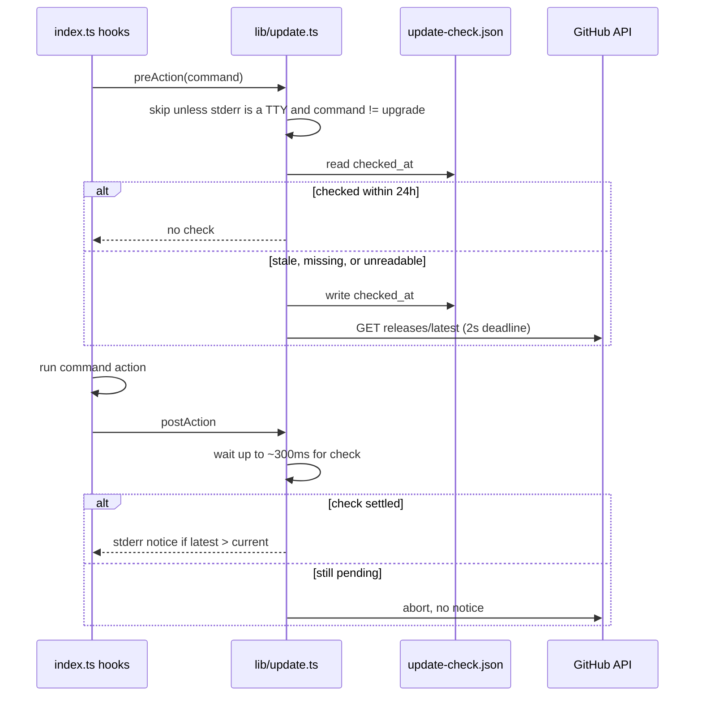
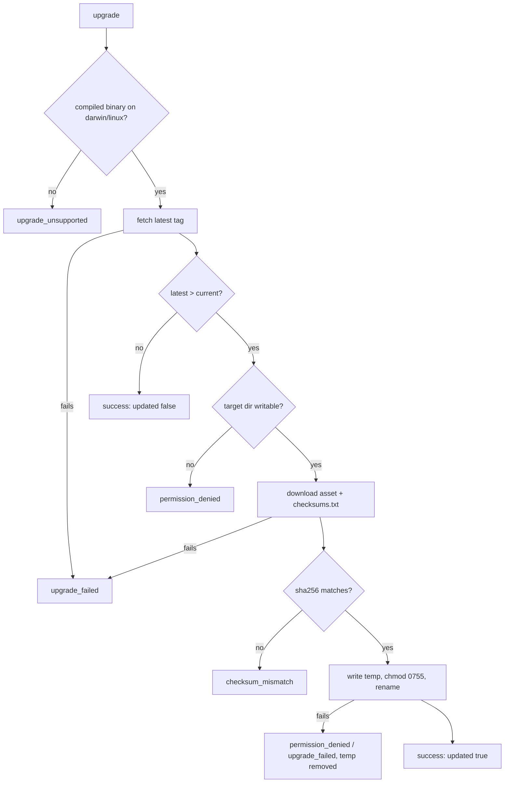

# CLI Install and Upgrade - Plan

## Goal Capsule

- **Objective:** A developer or AI-agent user who has never seen the project can install a working `dropbox-cli` with one command on macOS or Linux. When the install directory is not already on PATH, they are told the exact PATH line to add. They can keep the CLI current without reinstalling by hand.
- **Means:** An install script attached to each GitHub release (KTD2), a `dropbox-cli upgrade` command that swaps in a checksum-verified binary (KTD4, KTD5), and an interactive-only update notice (KTD6).
- **Product authority:** This Product Contract wins on product behavior; the Planning Contract's KTDs win on mechanism. Authentication and Dropbox app onboarding, Homebrew, npm, and Windows install channels are not active scope.
- **Execution profile:** One pull request containing U1–U6. No migration or stored-data change beyond a new, disposable update-check timestamp file.
- **Stop conditions:** Stop and report if a compiled binary cannot read its own version from the embedded `package.json`, or if replacing the running binary by rename cannot be made to work on macOS or Linux.
- **Who finishes:** `ce-work` implements and verifies; the end-to-end install from a real release can only be checked after the maintainer cuts the next tagged release.
- **Open blockers:** None.
- **Product Contract preservation:** Product Contract unchanged. The Deferred-to-Planning questions are resolved by KTD1–KTD7 and removed from Outstanding Questions.

---

## Product Contract

### Summary

A single `curl … | sh` command installs the right `dropbox-cli` binary from the latest GitHub release on macOS or Linux. A new `dropbox-cli upgrade` command replaces the installed binary with the latest release. In interactive terminals the CLI occasionally checks for a newer release and prints a one-line notice on stderr.

### Problem Frame

The project is public, and the release workflow already builds standalone binaries for macOS, Linux, and Windows on every `v*` tag. Nothing turns those binaries into an installed command. The README's Install step is `bun install`, which installs development dependencies and puts nothing on PATH. Someone who finds the repo today has to find the right release asset, download it, mark it executable, and move it onto PATH. Then they have to repeat all of that for every new version.

No outside user has reported this yet. The bet is that an easy install is a precondition for strangers adopting the tool, not a response to observed demand.

### Key Decisions

- **One channel: an install script backed by GitHub Releases.** It is the only option that meets "one command on macOS and Linux" without a new account, repository, or runtime, and it leaves room for the self-update command. (session-settled: user-directed — chosen over npm platform packages and a Homebrew tap: both need extra infrastructure and both let a package manager own updates, which conflicts with self-upgrade.) Governs R1–R6.
- **Updates come from a built-in `upgrade` command.** (session-settled: user-directed — chosen over re-running the install script and over package-manager updates: it gives users one obvious way to update.) Governs R7–R10.
- **The update check runs only in interactive terminals.** stdout is a machine contract, agents and the viewer run the CLI non-interactively, and machine commands have network-denied contract tests. (session-settled: user-directed — chosen over checking every invocation with backoff and over an env-var opt-out.) Governs R11–R13.
- **Downloads are checksum-verified before anything is replaced.** A truncated or corrupted download must never overwrite a working binary. (session-settled: user-approved — proposed during scope confirmation and accepted.) Governs R4, R9, R15.
- **Install without sudo into a user-writable directory and never edit shell config files.** (session-settled: user-approved — proposed during scope confirmation and accepted.) Governs R2, R3.
- **A release fails when its tag does not match the CLI's built-in version.** Otherwise a mismatch would show every user a permanent "new version available" notice. (session-settled: user-approved — proposed during scope confirmation and accepted.) Governs R16.
- **Install only; onboarding is unchanged.** After installing, users still create their own Dropbox app and run `auth login` exactly as they do today. (session-settled: user-directed — chosen over also improving onboarding docs or exploring a shared Dropbox app.)

### Actors

- A1. A developer who finds the repo and installs from a terminal.
- A2. An AI-agent user, or the agent itself, installing the CLI non-interactively in a sandbox or CI.
- A3. The maintainer cutting a release.
- A4. The viewer app, which bundles its own copy of the binary and runs machine commands non-interactively.

### Requirements

**Install**

- R1. A single documented command installs the latest release on macOS (arm64, x64) and Linux (arm64, x64), and the command's URL stays the same from release to release.
- R2. The installer puts the binary in a user-writable location without sudo or an interactive prompt, so A2 can run it unattended.
- R3. When the install location is not on PATH, the installer prints the exact line the user should add to their shell config and does not edit any shell config files itself.
- R4. The installer verifies the downloaded binary against the release's published checksum and exits non-zero without installing when verification fails.
- R5. Re-running the installer over an existing install replaces it with the latest release.
- R6. On an unsupported OS or CPU, the installer exits non-zero with a message that names the detected platform and points to the releases page.

**Upgrade**

- R7. `dropbox-cli upgrade` replaces the running binary with the latest release when the latest is newer, and reports the old and new versions.
- R8. When the installed version is already the latest, `upgrade` reports that and changes nothing.
- R9. `upgrade` verifies the checksum before replacing the binary and leaves the existing binary untouched on any failure (download, checksum, permissions).
- R10. `upgrade` follows the CLI output contract: a JSON envelope on stdout, human-readable progress with `--human`, and a non-zero exit with a structured error on failure.

**Update notice**

- R11. In an interactive terminal, the CLI checks for a newer release at most about once a day and prints a one-line notice on stderr naming the new version and `dropbox-cli upgrade`.
- R12. When stderr is not a terminal, the CLI makes no update-check request and prints no notice. This covers pipes, agents, CI, and the viewer.
- R13. A failed or slow update check never changes a command's output or exit code and never noticeably delays the command.

**Release**

- R14. The existing per-platform release asset names stay stable, because the installer and `upgrade` depend on them.
- R15. Every release publishes checksums for its binaries.
- R16. The release workflow fails before publishing when the pushed tag does not match the version the CLI reports.

**Docs**

- R17. The README's Install section leads with the one-line install command, followed by `dropbox-cli upgrade` and manual download from the releases page for other platforms. The command reference, `upgrade` help examples, and `CHANGELOG.md` are updated per the repo's documentation rules.

### Acceptance Examples

- AE1. Install location not on PATH
  - **Covers:** R2, R3
  - **Given** a fresh Linux machine whose PATH does not include the install location.
  - **When** the user runs the install command.
  - **Then** the binary is installed without sudo, and the output ends with the exact PATH line to add. No shell config file is modified.
- AE2. Corrupted download during install
  - **Covers:** R4
  - **Given** the downloaded binary does not match the published checksum.
  - **When** the installer runs.
  - **Then** it exits non-zero, installs nothing, and leaves any existing install in place.
- AE3. Unsupported platform
  - **Covers:** R6
  - **Given** Windows (outside a POSIX shell) or an unsupported CPU.
  - **When** the user runs the install command.
  - **Then** it exits non-zero, names the detected platform, and points to the releases page.
- AE4. Upgrade when already current
  - **Covers:** R8, R10
  - **Given** the installed version equals the latest release.
  - **When** the user runs `dropbox-cli upgrade`.
  - **Then** stdout carries a success envelope saying it is up to date, and the binary is unchanged.
- AE5. Upgrade without write permission
  - **Covers:** R9, R10
  - **Given** the binary was placed by hand in a directory the user cannot write.
  - **When** the user runs `dropbox-cli upgrade`.
  - **Then** it exits non-zero with a structured error saying why. The existing binary still runs.
- AE6. Non-interactive invocation
  - **Covers:** R12
  - **Given** the viewer or an agent runs `dropbox-cli info id:PHOTO --machine --expected-account ACCOUNT` with stdout and stderr piped.
  - **When** a newer release exists.
  - **Then** no request goes to GitHub and nothing extra appears on stderr.
- AE7. Offline interactive use
  - **Covers:** R11, R13
  - **Given** an interactive terminal with no network, and a day has passed since the last check.
  - **When** the user runs any command.
  - **Then** the command behaves exactly as it would online, and no notice or error appears.
- AE8. Tag and version mismatch
  - **Covers:** R16
  - **Given** the maintainer pushes `v1.2.0` but the CLI still reports `1.1.0`.
  - **When** the release workflow runs.
  - **Then** it fails before creating a GitHub release.

### Scope Boundaries

- Dropbox app setup, `auth login`, and a shared or built-in Dropbox app are unchanged.
- Homebrew tap, npm packages, Scoop/WinGet, AUR, and `.deb`/`.rpm` are deferred. They can reuse the same release assets later.
- No Windows install command. Windows binaries keep shipping on the releases page for manual download.
- No version pinning in the installer: it always installs the latest release.
- macOS code signing and notarization are deferred. Binaries downloaded with `curl` are not quarantined, so the install command does not need them.
- No special handling when `upgrade` is run against the viewer's bundled copy. The viewer is assumed never to run it.
- Release notes still use the whole `CHANGELOG.md`; trimming them to the current version is out of scope.

### Dependencies / Assumptions

- Assumes outside users will adopt the CLI once installing is easy. There is no observed demand yet.
- Assumes GitHub's unauthenticated API rate limits are enough for a daily, interactive-only check plus manual `upgrade` runs.
- Depends on GitHub Releases staying the single source of binaries and checksums.

### Sources / Research

- `.github/workflows/release.yml`: the existing tag-triggered matrix build and `gh release create` step. It publishes raw binaries with no checksums.
- `package.json` and `src/index.ts`: the version is currently declared in both.
- `README.md`: the Install section and the viewer machine-contract section, which describes a bundled copy.
- `src/lib/auth.ts`: the existing "interactive means stdin and stderr are TTYs" check.
- `docs/superpowers/specs/2026-04-15-dropbox-cli-design.md`: the original requirement for a single binary with no runtime dependencies.
- Prior art: opencode, Bun, and Deno ship `curl | sh` installers with self-update. The Supabase CLI (ADR 0011), esbuild, and Biome use npm platform packages. Personal Homebrew taps are commonly kept in sync with tools like homebrew-releaser.

---

## Planning Contract

### Key Technical Decisions

- KTD1. **`package.json` is the only version source.** `src/index.ts` imports `package.json` and passes its `version` to `.version()`; `src/lib/update.ts` reads the same import. A throwaway probe confirmed `bun build --compile` embeds an imported `package.json`, so compiled binaries report it. This removes the two-place drift that R16 guards against, and the release check compares the tag with what the CLI actually prints. Releases then bump only `package.json`, so `AGENTS.md` changes too.
- KTD2. **The install script is `install.sh` at the repo root, uploaded as an asset of every release.** The documented command is `curl -fsSL https://github.com/shaharmor/dropbox-cli/releases/latest/download/install.sh | sh`. GitHub's `releases/latest/download/<asset>` redirect keeps the URL fixed (R1) and ships the script together with the binaries it expects. Serving it from `master` was rejected because an unreleased script edit would reach users before matching assets exist. The script downloads `releases/latest/download/<asset>` and `releases/latest/download/checksums.txt`. It never calls the GitHub API, so it does not count against API rate limits. A release published between those two requests makes the checksum fail, which is safe because nothing gets installed (R4).
- KTD3. **The installer writes to `${DROPBOX_CLI_INSTALL_DIR:-$HOME/.local/bin}`.** `~/.local/bin` is user-writable, follows the XDG convention, and is already on PATH on many Linux distributions (R2). The override lets agents and CI pick a directory, and the installer tests use it instead of a real home directory. The installer writes a temporary file in the target directory and renames it over `dropbox-cli`. A running copy can keep running, and a failure leaves the existing install in place (R5, AE2).
- KTD4. **`upgrade` gets the latest tag from `GET https://api.github.com/repos/shaharmor/dropbox-cli/releases/latest`.** It downloads `releases/download/<tag>/<asset>` and `checksums.txt` for that exact tag. Versions are compared as numeric `major.minor.patch` (tags are `vX.Y.Z`, with no prereleases). A latest release that is equal to or older than the current version counts as up to date (R8). The GitHub endpoints are called with plain `fetch`, because `src/lib/api.ts` is reserved for Dropbox calls.
- KTD5. **Replacement is a checksum-checked write of a new file, then a rename over the resolved executable.** The target is `realpath(process.execPath)`. A compiled binary is detected by `Bun.main` starting with `/$bunfs/`. Running from source (`bun run dev`) fails with `upgrade_unsupported`, and so does Windows (see Assumptions). Write access to the target directory is checked after the version comparison and before the asset download, so an already-current install still reports up to date (R8, AE5). The new bytes are hashed with SHA-256 and compared with the `checksums.txt` entry for the asset. They are then written to a temp file next to the target, set to mode 0755, and renamed into place. Writing into the existing file is never done: macOS caches code signatures per inode, and a binary changed in place can be killed when it launches. Any failure removes the temp file and leaves the original untouched (R9).
- KTD6. **The update check runs alongside the command and finishes or is abandoned right after it.** A `preAction` hook starts the check only when all of these hold: `process.stderr.isTTY` is true, the command is not `upgrade`, and the timestamp in `<configDirectory()>/update-check.json` is missing, unreadable, or more than 24 hours old. A `postAction` hook waits at most about 300 ms more, then aborts the request. The fetch itself has a ~2 s deadline. The timestamp is written when the check starts, so at most one request goes out per day however the request ends. This also covers networks that hang instead of failing (AE7). A check aborted by a fast command shows no notice until the next day's check. The notice prints only when this run's check found a newer release, so it appears at most about once a day (R11). Every error is swallowed (R13). `--help` and `--version` exit inside Commander before `preAction` runs, so they never check. Commands that end through `printError`'s `process.exit` skip the notice too.
- KTD7. **The release workflow gets three changes.** A `version` job runs first and fails unless `v$(bun run src/index.ts --version)` equals `GITHUB_REF_NAME`, and `build` waits on it (R16, AE8). The `release` job writes `checksums.txt` in `sha256sum` format for every `dropbox-cli-*` binary (R15). `install.sh` and `checksums.txt` are added to the `gh release create` asset list. The matrix asset names are unchanged (R14).

### High-Level Technical Design

Update-check lifecycle for one interactive invocation:

`upgrade` decision flow:

### Assumptions

- `upgrade` is unsupported on Windows and returns `upgrade_unsupported` pointing to the releases page. Windows has no install command in scope, and replacing a running `.exe` needs a different swap.
- Linux binaries stay glibc builds. On musl systems such as Alpine, the installed binary will not run, and the installer does not detect this.
- Interactive means stderr is a TTY, as R12 frames it. This is narrower than `src/lib/auth.ts`, which also requires stdin to be a TTY for prompting.
- The update-check timestamp lives in the config directory, which `ensureProtectedDirectory()` creates with mode 0700 if it is missing. If the directory fails its permission checks, the update check is skipped silently.
- `upgrade` success data is `{ previous_version, version, updated }`. Error codes are `upgrade_unsupported`, `permission_denied`, `upgrade_failed`, and `checksum_mismatch`.
- On Rosetta, the installer treats an x86_64 shell on Apple Silicon (`sysctl.proc_translated` = 1) as arm64.

### Scope Boundaries (planning)

Considered and not built:

- **No `DROPBOX_CLI_NO_UPDATE_CHECK` opt-out.** The Product Contract chose interactive-only over an env-var opt-out. Revisit if users report the notice as noise.
- **No signature verification (cosign/minisign).** Checksums from the same release protect against corrupted downloads, not a compromised release. Signing would need key management. Revisit if the project gains outside users who need provenance.
- **No wget fallback in the installer.** The documented command already needs `curl`.

### Risks

- The README's install command returns 404 until the first release that includes `install.sh` and `checksums.txt`. The maintainer should cut a release soon after merge, and this PR does not bump the version (repo rule).
- `tsconfig.json` has `rootDir: "src"` and no `resolveJsonModule`, so importing `../package.json` will fail `tsc` until the config is adjusted (U1).
- The unauthenticated GitHub API allows 60 requests per hour per IP. Shared CI egress IPs could hit that limit for `upgrade`, but the notice never runs in CI (R12).

---

## Implementation Units

### U1. Single version source and release workflow

- **Goal:** The CLI reports the `package.json` version, and every release fails on a tag/version mismatch and publishes checksums and the installer.
- **Requirements:** R14, R15, R16, AE8; KTD1, KTD7.
- **Dependencies:** none.
- **Files:** `src/index.ts`, `tsconfig.json`, `.github/workflows/release.yml`, `AGENTS.md`, `tests/integration/version.test.ts` (new).
- **Approach:**
  1. Import `package.json` in `src/index.ts` and pass its version to `.version()`. Adjust `tsconfig.json` (`resolveJsonModule`, and `rootDir` or `include`) so `bun run typecheck` passes.
  2. Add the `version` job and make `build` need it. Generate `checksums.txt` in `release` and include `install.sh` and `checksums.txt` in the release assets.
  3. Update the AGENTS.md "Releases" step 1 to bump only `package.json`.
- **Patterns to follow:** existing `oven-sh/setup-bun@v2` and `bun install` steps in `.github/workflows/release.yml`. Spawn the CLI from tests the way `tests/integration/machine-contract.test.ts` does.
- **Test scenarios:**
  - Running `src/index.ts --version` prints exactly the `version` field of `package.json`.
- **Verification:** `bun run typecheck` passes. `bun run build` produces a binary whose `--version` matches `package.json`. The workflow YAML parses, `build` lists `needs: version`, and the asset names are unchanged.

### U2. Release lookup, version comparison, and verified binary replacement

- **Goal:** One library module that finds the latest release, compares versions, and replaces a binary only after checksum verification.
- **Requirements:** R7, R8, R9; KTD4, KTD5.
- **Dependencies:** U1.
- **Files:** `src/lib/update.ts` (new), `tests/lib/update.test.ts` (new).
- **Approach:**
  1. Export a latest-release lookup that returns the tag and normalized version, a numeric semver comparison, and the platform asset name (`dropbox-cli-<darwin|linux>-<arm64|x64>`, with no asset for other platforms).
  2. Export a replace function that takes the target path, tag, and asset name, so tests can point it at a temp file. It parses `checksums.txt` lines of the form `<hex>  <name>`.
  3. Throw typed errors carrying the codes listed in Assumptions (`upgrade_unsupported`, `permission_denied`, `upgrade_failed`, `checksum_mismatch`) so the command can map them to `printError`.
- **Patterns to follow:** `fs` and `crypto` usage in `src/lib/config.ts` (temp file then rename, cleanup in `finally`). Mock `globalThis.fetch` as in `tests/lib/api.test.ts`.
- **Test scenarios:**
  - The latest-release lookup parses `tag_name: "v1.2.0"` as `1.2.0`. A non-2xx response or a missing `tag_name` throws `upgrade_failed`.
  - The comparison treats `1.10.0` as newer than `1.9.0`, `1.0.0` as equal to `1.0.0`, and `0.9.0` as older than `1.0.0`.
  - The asset name is correct for darwin/arm64, darwin/x64, linux/arm64, and linux/x64, and win32 or ia32 gets no asset.
  - Replace with a matching checksum swaps the temp target's contents, sets mode 0755, and leaves no temp files.
  - Replace with a mismatched checksum throws `checksum_mismatch`, and the target bytes are unchanged. (Covers AE2-style protection for `upgrade`.)
  - Replace when `checksums.txt` has no line for the asset throws `checksum_mismatch` without writing.
  - Replace when the asset download returns 404 throws `upgrade_failed`, and the target is unchanged.
  - Replace into a read-only directory throws `permission_denied` before downloading the asset, and the target is unchanged. (Covers AE5.)
- **Verification:** `tests/lib/update.test.ts` passes with fetch mocked and no live network.

### U3. `upgrade` command

- **Goal:** `dropbox-cli upgrade` upgrades a compiled install, reports old and new versions, and follows the output contract.
- **Requirements:** R7, R8, R9, R10, AE4, AE5; KTD5.
- **Dependencies:** U2.
- **Files:** `src/commands/upgrade.ts` (new), `src/index.ts` (register in alphabetical order), `tests/commands/upgrade.test.ts` (new).
- **Approach:**
  1. Refuse with `upgrade_unsupported` unless `Bun.main` starts with `/$bunfs/` and the platform has an asset.
  2. Resolve the target as `realpath(process.execPath)` and call U2. Print `{ previous_version, version, updated }` with `printSuccess`, and map typed errors to `printError(code, message)`.
  3. Send progress through `logHuman`. Add `.addHelpText("after", ...)` examples.
- **Patterns to follow:** `src/commands/mkdir.ts` for registration and help text. Mock `../../src/lib/update` and `../../src/lib/output` as in `tests/commands/mkdir.test.ts`.
- **Test scenarios:**
  - Covers AE4. When latest equals current, stdout data is `{ previous_version: "1.0.0", version: "1.0.0", updated: false }` and replace is not called.
  - When latest is newer, replace is called with the resolved executable path, tag, and asset, and the data shows `updated: true` with both versions.
  - Covers AE5. When replace throws `permission_denied`, the command calls `printError("permission_denied", …)`.
  - Running from source makes the command report `upgrade_unsupported` without any fetch.
- **Verification:** The command tests pass. `bun run dev -- upgrade` returns an `upgrade_unsupported` JSON envelope with a non-zero exit. `dropbox-cli upgrade --help` shows the examples.

### U4. Interactive-only update notice

- **Goal:** Interactive users see a one-line stderr notice about a newer release at most about once a day. Non-interactive runs make no request.
- **Requirements:** R11, R12, R13, AE6, AE7; KTD6.
- **Dependencies:** U2.
- **Files:** `src/lib/update.ts`, `src/index.ts` (preAction/postAction hooks), `tests/lib/update.test.ts`, `tests/integration/update-notice.test.ts` (new).
- **Approach:**
  1. Add start and finish functions to `src/lib/update.ts`. Read and write `update-check.json` through `configDirectory()` and `ensureProtectedDirectory()` from `src/lib/auth-coordination.ts`.
  2. Call start from the existing `preAction` hook with the action command's name. Await finish in a new `postAction` hook.
  3. The notice text is `A new version of dropbox-cli is available: <current> → <latest>. Run "dropbox-cli upgrade" to update.` and is written with `logError`.
- **Execution note:** Prove AE6 with a subprocess test using piped stdio before wiring the hooks, so the non-interactive guarantee is checked from outside the process.
- **Test scenarios:**
  - Covers AE6. With stderr piped (non-TTY), `info id:PHOTO --machine --expected-account A` makes no request to `api.github.com`, and stderr has no notice. Use the fixture's fetch stub, which records URLs.
  - When stderr is a TTY, the timestamp is stale, and latest is newer, start records `checked_at` and finish writes the notice once.
  - When stderr is a TTY and `checked_at` is less than 24 h old, no fetch is made.
  - Covers AE7. When stderr is a TTY and fetch rejects with a network error, there is no output and `checked_at` is recorded.
  - When the fetch is still pending after the post-command wait, it is aborted and nothing prints. `checked_at` is already recorded, so the next run makes no request.
  - A corrupt `update-check.json` is treated as stale and does not throw.
  - Running the `upgrade` command never starts a check.
  - When latest equals current, no notice prints.
- **Verification:** The new tests pass, and the existing `tests/integration/*` machine-contract tests still pass unchanged.

### U5. Install script

- **Goal:** One `curl … | sh` command installs the verified latest binary on macOS or Linux, without sudo and without editing shell config.
- **Requirements:** R1, R2, R3, R4, R5, R6, AE1, AE2, AE3; KTD2, KTD3.
- **Dependencies:** U1 (asset and checksum names).
- **Files:** `install.sh` (new), `tests/install.test.ts` (new).
- **Approach:**
  1. Write POSIX `sh` with `set -eu`. Put the whole body in a function that is called on the last line, so a truncated download runs nothing.
  2. Map `uname -s` and `uname -m` to an asset, including the Rosetta check. On anything else, exit non-zero, name the platform, and link `https://github.com/shaharmor/dropbox-cli/releases`.
  3. Download the asset and `checksums.txt` into `mktemp -d` with `curl -fsSL`. Verify with `sha256sum`, or `shasum -a 256` when it is missing. Exit non-zero if neither tool exists or the hashes differ.
  4. Run `mkdir -p` on the install dir, copy to a temp file there, `chmod 755`, then `mv` it over `dropbox-cli`. Print the installed version from `dropbox-cli --version`.
  5. If the dir is not on `$PATH`, print the exact `export PATH="<dir>:$PATH"` line and the shell config file it belongs in, chosen from `$SHELL`. Never write to that file.
- **Patterns to follow:** spawn and temp-dir cleanup in `tests/lib/auth-fixture.ts`.
- **Execution note:** Test with stub `curl` and `uname` executables placed first on `PATH`, serving fixture files from a temp dir. Do not add test-only knobs to the script.
- **Test scenarios:**
  - Covers AE1. Linux/x86_64 with an install dir not on PATH: the binary is installed and executable, the output ends with the `export PATH=` line, and `$HOME` contains no new or changed dotfiles.
  - Covers AE2. A fixture checksum that does not match gives a non-zero exit, and an existing `dropbox-cli` in the install dir is byte-for-byte unchanged.
  - Covers AE3. `uname -s` of `MINGW64_NT` or `uname -m` of `i686` gives a non-zero exit, and stderr names the platform and the releases URL.
  - When the fixture `checksums.txt` has no line for the detected asset, the installer exits non-zero, and an existing `dropbox-cli` is byte-for-byte unchanged.
  - Re-running over an existing install replaces it with the fixture binary (R5).
  - An install dir already on PATH prints no PATH instructions.
  - The stub `curl` sees requests only for `releases/latest/download/` URLs.
- **Verification:** `tests/install.test.ts` passes on macOS and on CI's Ubuntu runner. `sh -n install.sh` succeeds.

### U6. Documentation

- **Goal:** Users find the one-line install, `upgrade`, and the manual download path, and the changelog records the change.
- **Requirements:** R17.
- **Dependencies:** U3, U4, U5.
- **Files:** `README.md`, `CHANGELOG.md`.
- **Approach:**
  1. In `README.md`, rewrite Setup → Install to lead with the curl command, then describe `DROPBOX_CLI_INSTALL_DIR`, `dropbox-cli upgrade`, and manual download from the releases page. Move `bun install` to a "From source" note.
  2. Add an `upgrade` entry to the command reference in alphabetical position, and a sentence about the interactive-only update notice.
  3. Add `CHANGELOG.md` entries under `## Unreleased`. Added: the installer, `upgrade`, the update notice, and release checksums. Changed: the release fails on a tag/version mismatch, and the version now comes only from `package.json`.
- **Test expectation:** none, documentation only.
- **Verification:** The README commands match the implemented flags and URLs. The CHANGELOG entries sit under `## Unreleased`.

---

## Verification Contract

| Gate | Command / check | Proves |
|---|---|---|
| Type-check | `bun run typecheck` | KTD1's JSON import and the new modules compile |
| Tests | `bun run test` (uses `--isolate`) | U1–U5 scenarios, and that the existing machine-contract tests still pass |
| Build smoke | `bun run build`, then `dist/dropbox-cli --version` and `dist/dropbox-cli upgrade --help` | The compiled binary embeds the version and registers `upgrade` |
| Source refusal | `bun run dev -- upgrade` | Exits non-zero with an `upgrade_unsupported` envelope |
| Installer syntax | `sh -n install.sh` | The POSIX script parses |
| Workflow review | Read `.github/workflows/release.yml` | The `version` job gates `build`, checksums and `install.sh` are uploaded, and asset names are unchanged |

An end-to-end install and upgrade against a real release cannot be verified until the maintainer pushes the next `v*` tag.

---

## Definition of Done

- U1–U6 are implemented, and every listed test scenario exists and passes under `bun run test`.
- `bun run typecheck` and `bun run build` succeed, and the built binary's `--version` equals `package.json`.
- No stdout output besides JSON envelopes. The notice and progress go to stderr (AGENTS.md output contract).
- No live network in tests. GitHub and download calls are stubbed.
- README, the `upgrade` help text, and CHANGELOG are updated (R17). AGENTS.md describes the one-file version bump.
- No version bump, tag, or release is made.
- Abandoned experiments, debug logging, and scratch files are removed from the diff.
